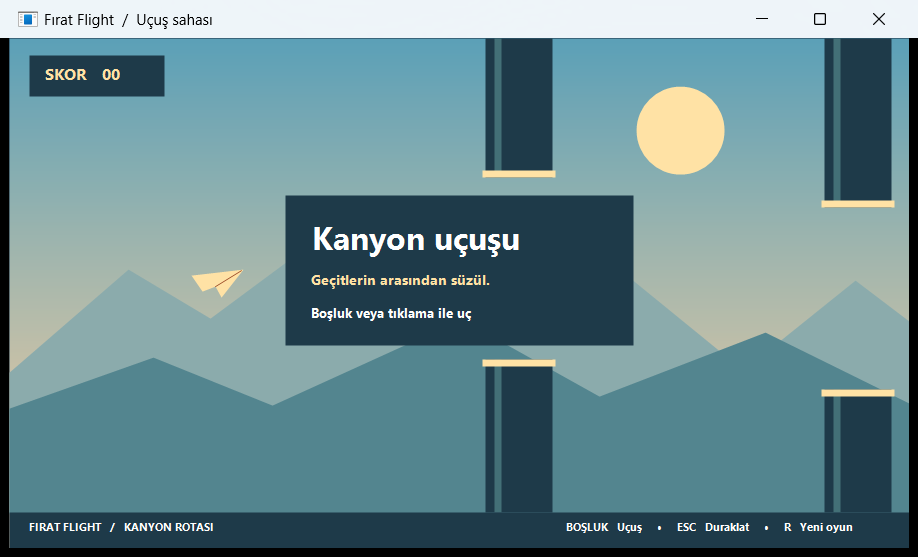
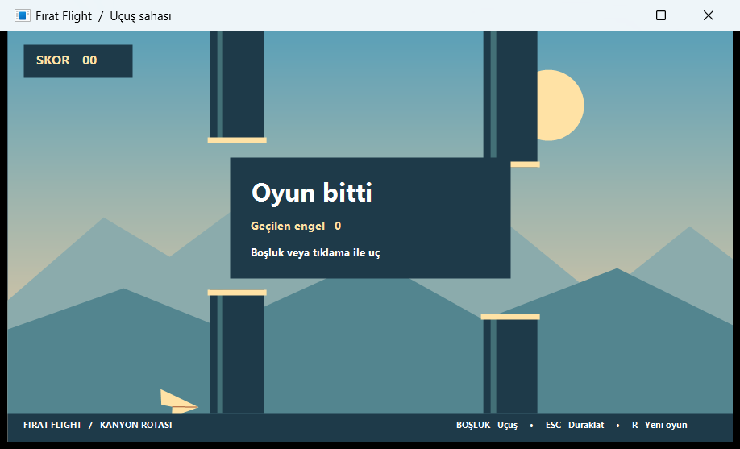

# Fırat Flight

Kâğıt uçağı kanyon geçitlerinden uçuran, tüm manzarası ve oyuncu çizimi kodla üretilen bir masaüstü oyunu.

**YMH219 Nesne Tabanlı Programlama** · Muhammed AHMED · 250541604

## Kullanılan teknolojiler

C#, .NET 10 ve Windows Forms. GDI+ çizim araçları, WinForms Timer, Stopwatch. Haricî paket gerekmez.

## Kurulum ve çalıştırma

Windows 10/11 x64 üzerinde Git ve .NET 10 SDK gerekir. SDK kurulumunu `dotnet --list-sdks` ile kontrol edebilirsiniz. [Microsoft .NET 10 indirmeleri](https://dotnet.microsoft.com/download/dotnet/10.0)

```powershell
git clone https://github.com/MuhammedAHMED7/YMH219-FlappyBird.git
cd YMH219-FlappyBird
dotnet restore
dotnet build -c Release
dotnet run -c Release --no-build
```

Visual Studio'da .NET 10 destekli bir sürüm ve **.NET masaüstü geliştirme** iş yüküyle `FlappyBird.csproj` dosyasını açıp F5'e basabilirsiniz.

## Temel özellikler ve kullanım

1. **Boşluk** veya sol tık ile uçuşa başlayın. Her ayrı basış uçağa yukarı hız verir. Aralarda yer çekimi etkilidir.
2. Üst ve alt kulelerin arasından geçin. Her geçit bir puandır. Ekrandan çıkan geçit farklı yükseklikte geri gelir.
3. Tavana, zemine veya kuleye çarpınca uçuş biter. **R** başlangıç ekranına döner. Oyun sonu ekranında boşluk veya tık doğrudan yeni uçuşu başlatır.

Esc uçuşu duraklatır. Başka pencereye geçtiğinizde oyun otomatik duraklar. Boşluk veya tıklama konum ve hızı koruyarak uçuşu sürdürür. Durgun ekranlarda oyun zamanlayıcısı kapanır.

## Sınıflar ve sorumluluklar

`Flight` yer çekimini, hızı, skoru ve oyun durumunu yönetir. `Gate` açıklığın konumunu ve o geçidin puanlanıp puanlanmadığını tutar. `MainForm` klavye ve fare olaylarını modele iletir. Timer geçen süreyle modeli ilerletir. Çizim, sabit oyun alanını pencereye orantılı ölçekler.

## Ekran görüntüleri





## Test ve bilinen sınırlamalar

Klavye ile yükselme, zemin ve engel çarpışması, yeniden başlama ve skorun sıfırlanması sınandı. Beş geçit boyunca skor ve engellerin yeniden kullanımı doğrulandı. Pencere iki boyutta açıldı. Skor oturum boyunca tutulur.
